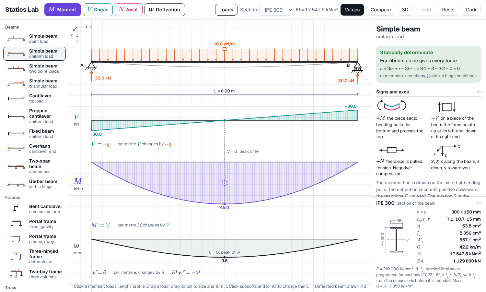
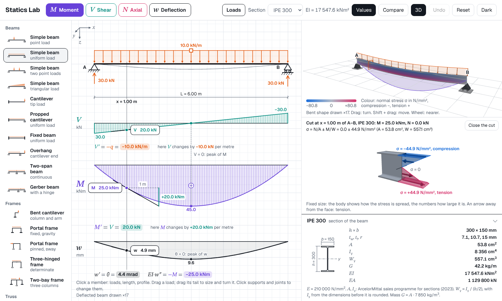

# Statics Lab

Version 20 · 27 November 2026

An interactive page for learning the statics of beams, frames and trusses in the plane.
Change a load, a support, a length or a profile, and the reactions, the lines of N, V and M and the bent shape follow at once, together with the formulas that link them.

It is one HTML file. It needs no installation and no server, and it calls no other server: open `dist/index.html` in a browser.

## What it shows

- 16 examples: ten beams (simple beam, cantilever, propped cantilever, fixed beam, overhang, two spans, Gerber beam), five frames and a truss.
- Loads: point loads at any place and angle, uniform, triangular and trapezoidal loads. Drag them or type them.
- Supports and hinges change by a click. So do the lengths and the profiles (IPE 200 to IPE 400, HEB 200, HEB 300).
- Reactions, axial force N, shear V, moment M, deflection w and rotation θ, with the values at the mouse.
- Under each line the relation that makes it, M′ = V, V′ = −q, w′ = θ and EI·w″ = −M, with the numbers of the place under the mouse.
- "By hand" cards: the hand formulas of each example with its numbers put in.
- The count of statical determinacy. A structure that can move says why, and how to hold it.
- A 3D view beside the sheet: the structure as a body with its profile, coloured by its stress. The member is cut open at the mouse and shows the normal stress σ = N/A ± M/W or the shear stress τ = V·S/(I·t).
- Compare (the state before a change stays on the sheet), a light and a dark sheet.

## What it is not

It is a teaching tool, not a design program. It makes no check to any code.

- Plane structures, first-order theory (small deflections), linear elastic material.
- Bending after Euler–Bernoulli: no shear deformation. E = 210 000 N/mm².
- No stability, no second-order effects, no dynamics.

## Signs and units

- x runs along the beam, z points down, y toward the viewer.
- +M: the piece sags, bending pulls the bottom. The moment line is drawn on the side that bending pulls.
- +V: on a piece of the beam the force points up at its left end and down at its right end.
- +N: tension. Negative: compression.
- The deflection w counts positive downward, the reactions upward. The rotation θ = w′ is positive where the line falls to the right.
- Forces in kN, moments in kNm, lengths in m, deflections in mm, rotations in mrad, stresses in N/mm².

## Build

    node build.js            # writes dist/index.html
    node build.js --debug    # writes dist/debug.html, which the browser checks use

Node.js 18 or newer. No packages are needed.

## Checks

    node test/solver.test.js
    node test/cards.test.js
    node test/sections.test.js
    bash test/run_all.sh out/checks      # every check, about 40 minutes

The numeric checks need Node.js only. The checks in `test/independent` compare the page with a second solver, written in Python, that shares no code with it; they need Python 3 with `numpy`.
The browser checks need Python 3 with `playwright` and a Chrome or Chromium: either Playwright's own (`playwright install chromium`) or the one named in the variable `CHROME`.

`test/run_all.sh` writes `numeric.txt`, `browser.txt` and `status.txt` into the folder given and ends with status 0 only when every check ran and passed.

## The source

| File | What it holds |
|---|---|
| `src/solver.js` | The analysis: direct stiffness method, exact forces along the members, turning points, mechanisms |
| `src/presets.js` | The examples and the list of profiles |
| `src/cards.js` | The hand formulas of the examples |
| `src/view3d.js` | The 3D view, in plain WebGL |
| `src/app.js` | The sheet: drawing, mouse, menus |
| `src/style.css`, `src/index.template.html` | The page |
| `fonts/` | The two fonts of the page, built into it by `build.js` |
| `test/` | The checks |

No library is used. The comments say why a rule is as it is. Where a rule came from a fault found in a review, the comment names the review and the number of the finding.

## Licence

Free for everyone. You may use, change and share Statics Lab, also inside your own products, free of charge.
The one condition: the file `LICENSE` with its copyright line stays with every copy (MIT licence). There is no warranty.

The fonts have their own licence: see `THIRD-PARTY.md`.
